# UWB-NLoS-LoS-Classification-for-KF
Research of NLoS probability calculation model based on UWB CIR using deep learning

[Abstract]  
-Classify the environment(LoS/NLoS) by analyzing CIR  
-The NLoS probability will be used as a parameter to update the process noise covariance in the KF

[Additional]  
-Try CNN+LSTM to improve accuracy

> Set all environment as follows:
1. [Reference Journal #1: Accurate Indoor Positioning for UWB-Based Personal Devices Using Deep Learning](https://ieeexplore.ieee.org/document/10054386)
2. [Reference Paper #2: UWB NLOS/LOS Classification Using Deep Learning Method](https://ieeexplore.ieee.org/document/9108193)

[DataSet]  
-Use data set and some function from https://github.com/ewine-project/UWB-LOS-NLOS-Data-Set.git  
-Get reference from https://github.com/JSYoon-git/UWB-LOS_NLOS-Classification-using-DL.git

---

## 1. Theory

  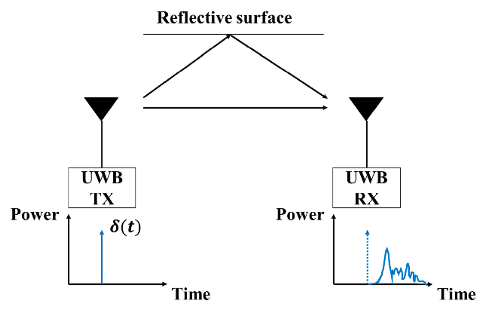 
  <b>Fig. 1.</b> TX/RX form of a UWB-based communication system [1]

The transmitted impulse reaches the receiver as a CIR (Channel Impulse Response) distorted by the propagation environment. Environments are divided into **LoS** (e.g. open space) and **NLoS** (e.g. in a pocket or bag), which differ in signal distortion and delay. LoS measurements have small errors and can be trusted, while NLoS measurements are less reliable due to noise.

  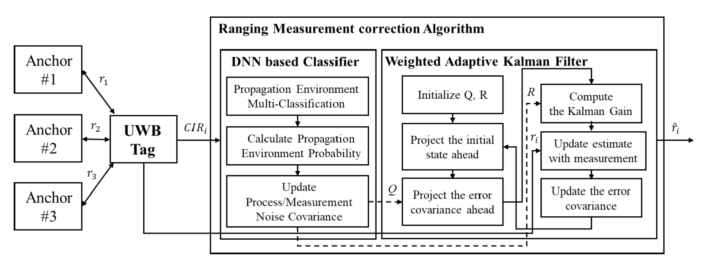 
  <b>Fig. 2.</b> Ranging measurement correction algorithm [1]

The algorithm takes the extracted CIR as input:

1. The classifier distinguishes LoS/NLoS and provides an **NLoS probability**.
2. The process / measurement noise covariances **Q** / **R** are updated.
3. The error covariance and Kalman gain of the Kalman filter are updated.
4. A corrected estimate is computed, and the state error covariance **P** is updated for the next step.

  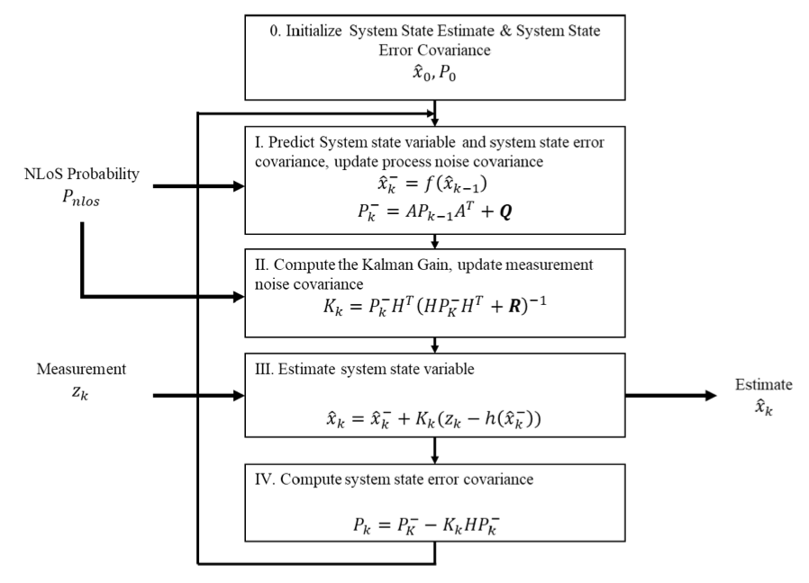 
  <b>Fig. 3.</b> Use of the NLoS probability in the Kalman filter [1]

**Operation in an NLoS environment**

- Measurement reliability drops, so **R** (measurement noise covariance) increases.
- As R increases, the Kalman gain **K** decreases.
- The filter trusts its prediction more and the noisy (distorted) measurement less.

## 2. Dataset

Each sample contains 15 measurement fields, the `NLOS` label (0 = LoS, 1 = NLoS), and **1016 CIR values** (`CIR0`–`CIR1015`). The CIR can be viewed as a 3D surface of (time, index, amplitude), projected onto (time, index), or sliced at one time step as (index, amplitude).

  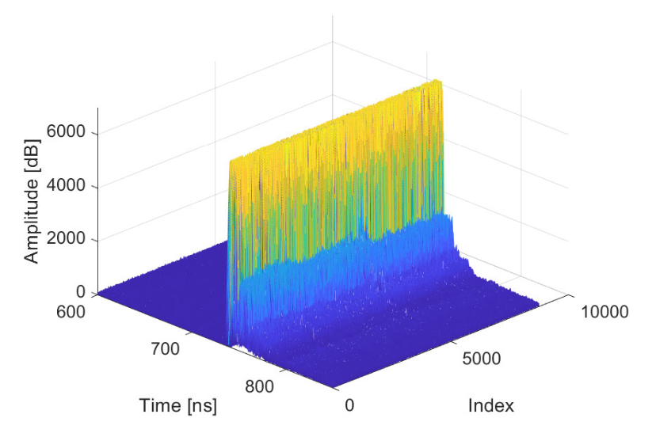 
  <b>Fig. 4.</b> CIR data in a LoS case: 3D (time, index, amplitude) [1]

<table>
  <tr>
    <td align="center" width="50%">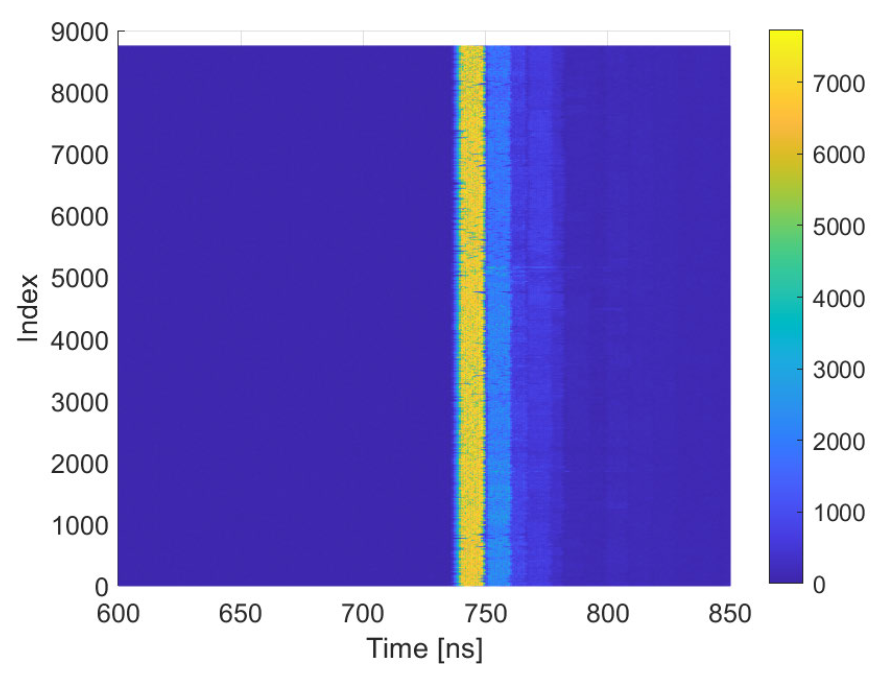 <b>Fig. 5.</b> Projection on amplitude: 2D (time, index) [1]</td>
    <td align="center" width="50%">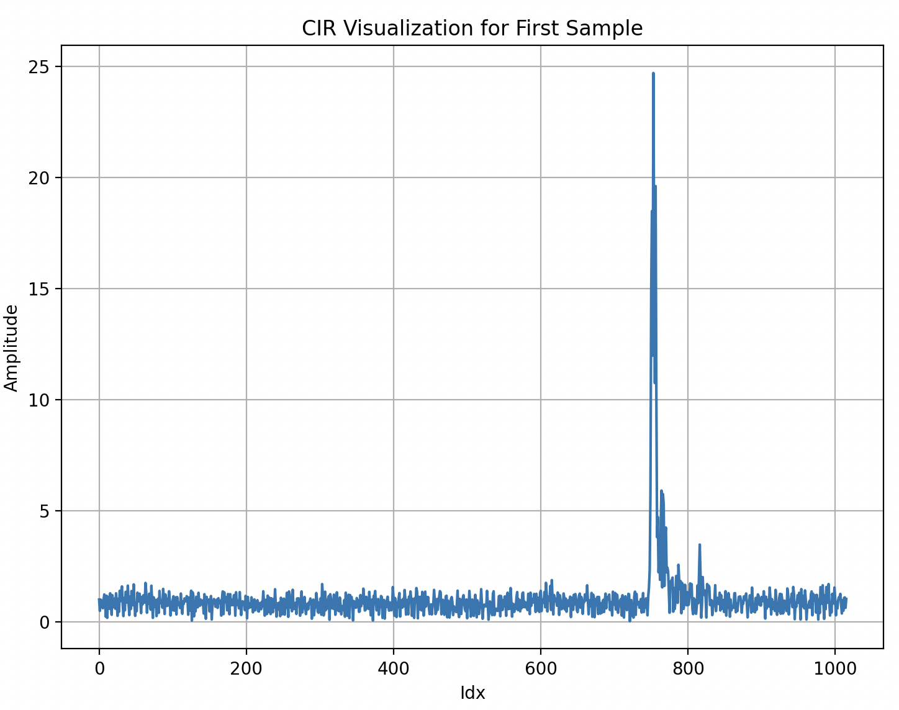 <b>Fig. 6.</b> Slice on time: 2D (index, amplitude)</td>
  </tr>
</table>

## 3. Experimental Results

Data split: train / validation / test = 81 : 9 : 10 (stratified, `random_state=42`).

| Model | Architecture | Epochs | LR | Accuracy |
|---|---|:---:|:---:|:---:|
| DNN | FC 512 → 256 → 2 | 100 | 0.01 | 0.5000 |
| CNN | Conv1d(10, k4) → Conv1d(20, k5) → MaxPool → FC 128 | 10 | 0.01 | 0.7413 |
| CNN | 〃 | 10 | 0.001 | 0.8559 |
| **CNN + LSTM** | **Conv1d ×2 → BiLSTM(32, 2 layers) → FC 128** | **100** | **0.001** | **0.9616** |

### 3.1 DNN

  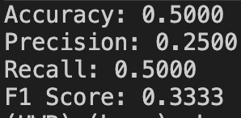 
  <b>Fig. 7.</b> DNN evaluation metrics

The DNN was evaluated only as a simple baseline. Precision 0.25 with recall 0.5 indicates that it predicted a single class for every sample.

### 3.2 CNN

  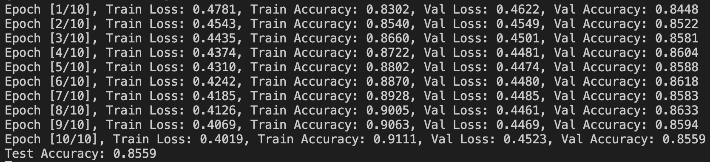 
  <b>Fig. 8.</b> CNN training log (batch size and epochs from [2], LR = 0.001)

  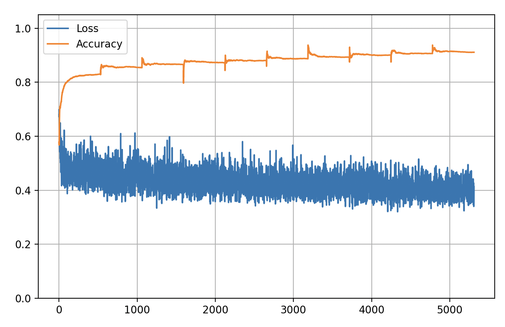 
  <b>Fig. 9.</b> CNN training loss and accuracy

### 3.3 CNN + LSTM

  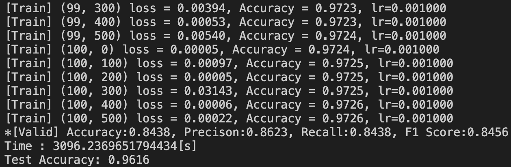 
  <b>Fig. 10.</b> CNN + LSTM training log

  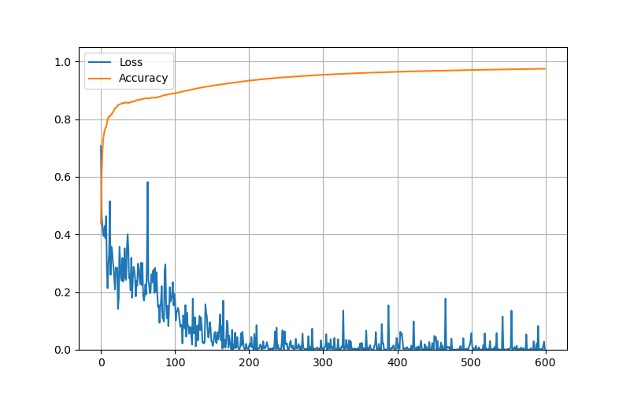 
  <b>Fig. 11.</b> CNN + LSTM training loss and accuracy

Combining a BiLSTM with the CNN to learn the temporal pattern of the CIR raised accuracy from **0.86 to 0.96**. The model with the best performance will be used to extract NLoS probabilities from DWM-1000 measurement data for Kalman filter correction.

## References

[1] [Accurate Indoor Positioning for UWB-Based Personal Devices Using Deep Learning](https://ieeexplore.ieee.org/document/10054386)  
[2] [UWB NLOS/LOS Classification Using Deep Learning Method](https://ieeexplore.ieee.org/document/9108193)  
[3] [ewine-project/UWB-LOS-NLOS-Data-Set](https://github.com/ewine-project/UWB-LOS-NLOS-Data-Set)  
[4] [JSYoon-git/UWB-LOS_NLOS-Classification-using-DL](https://github.com/JSYoon-git/UWB-LOS_NLOS-Classification-using-DL)
